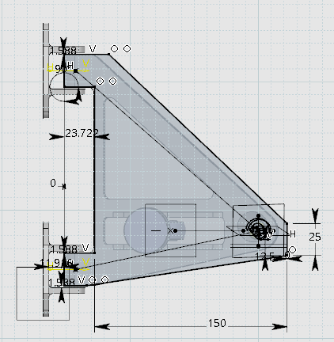

# Lower Control Arm — Topology Optimization Study

**Blue Sky Solar Racing · Gen 13 · Mechanical/Structural Design · Fall 2026**

A documentation-led study exploring how topology optimization and design for additive manufacturing can reduce structural mass while preserving critical suspension interfaces, fastening access, and manufacturing constraints.

> **Project status:** Design-space modelling, multi-load-case structural setup, topology optimization and facet cleanup were documented. Final mass reduction, fatigue performance, manufacturability, and production approval are **not yet verified**; no final percentage weight saving is claimed.

## Visual overview

The two images below are the **same project graphics used in my engineering portfolio slides**, captured from the Gen 13 topology-optimization research notebook.

| CATIA design space and mounting geometry | ANSYS topology-optimized output |
| :---: | :---: |
|  |  |
| *Original LCA design-space drawing, including the interface locations and dimensions.* | *Topology-optimized structural result in ANSYS. A final verified production part is not claimed.* |

The images are checked into this repository so they remain viewable without access to the original slide deck.

## 1. Engineering problem
The lower control arm (LCA) must transfer loads between the front suspension, chassis, damper/eye bolt, and upright. The design challenge is to identify removable material without compromising the geometric and mechanical interfaces that cannot change.

## 2. CAD design space — CATIA
1. Reconstructed the LCA envelope using the existing suspension assembly as reference.
2. Located and preserved the front suspension clevis attachment points, spring/bottom eye-bolt interface, and spherical-bearing mount.
3. Modelled threaded and bearing pockets by projecting reference geometry and defining supporting planes and axes.
4. Checked fastener selection and practical service accessibility, including a socket-clearance region and open-end wrench sweep.
5. Exported the design space as a STEP file for structural analysis.

**Design constraints:** Non-design regions around mounts, bearing locations, required holes and tool clearances. The notes identify an **AN4-15** fastener as a candidate for the eye-bolt arrangement, and discuss the bearing retaining ring identified as **McMaster-Carr 99142A390**. These are design-study references rather than a validated final bill of materials.

## 3. Finite element model — ANSYS Mechanical
- Defined a **seven-step static structural analysis** to represent multiple suspension load cases, based on team force tables for cornering, braking and bump loads.
- Investigated **6060 aluminium** as a material within the working model.
- Applied local mesh refinement around edges, faces and interfaces.
- Preserved mount/connection interfaces with local geometric restrictions.
- Used **remote displacement conditions at J and K**, distributing allowable degrees of freedom to avoid over-constraining the common mounting axis.
- Applied **remote forces** at spring and bearing load-transfer interfaces.
- Added reaction-force probes and inspected the structural setup prior to topology optimization.

These values and settings reflect the research notebook; they should be checked against the current team's authoritative FEA model before fabrication.

## 4. Topology optimization and post-processing
1. Generated topology-optimized geometry from the analysis.
2. Re-imported the resulting faceted geometry into a new static structural workflow.
3. Used **ANSYS SpaceClaim** facet checking and automatic repair.
4. Smoothed and reduced triangles, repeatedly checking until no facet errors remained.

## 5. Validation still required
A potential production design requires renewed FEA and mechanical verification after creating a manufacturable CAD model: stress and deformation across all load cases, fatigue, buckling where relevant, fastening/assembly checks, minimum feature size, alloy/material suitability, and manufacturing cost.

## Engineering skills demonstrated
**CATIA · ANSYS Mechanical · SpaceClaim · Structural mechanics · FEA meshing · Boundary-condition modelling · Topology optimization · Design for Manufacturing · Suspension integration**

## Source
[Topology Optimization Study — Metal 3D Printing / Gen 13 research notebook](https://docs.google.com/document/d/1Oca47-44fIc8f-CNj-8ILTpGa0cdTfizLmUNSFZSeYw/edit?tab=t.j5j1hb8ok9pr)

*Group project context: Blue Sky Solar Racing. Documentation describes the author's design-study contributions, not a validated final vehicle component.*
