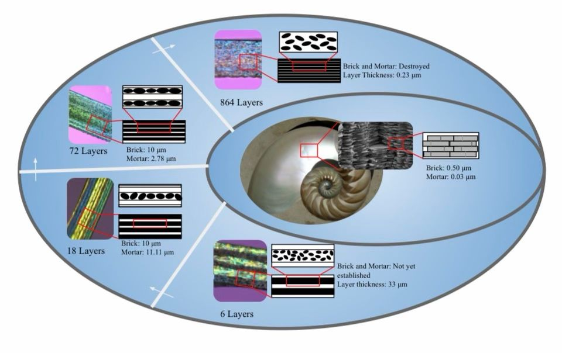
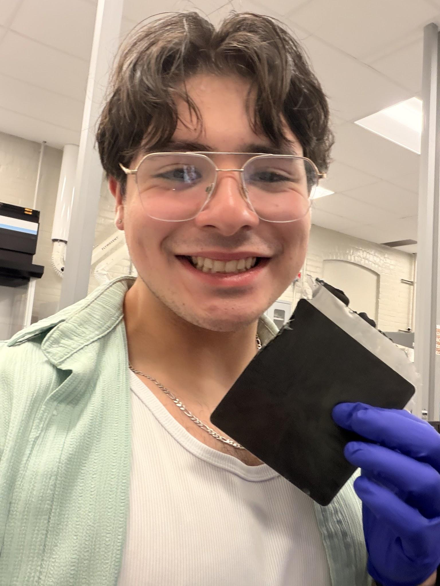
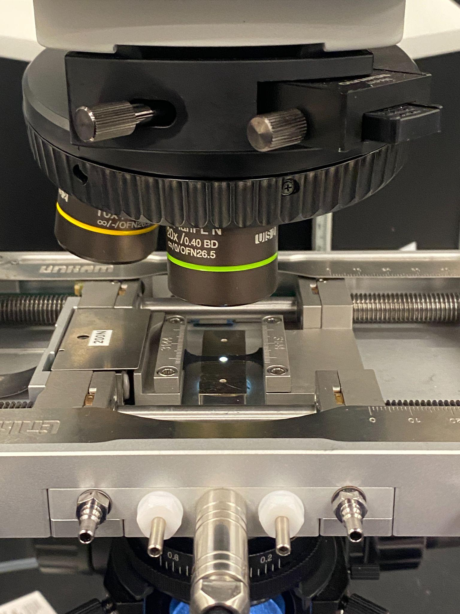
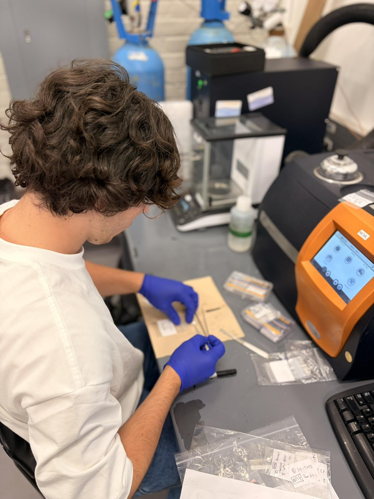
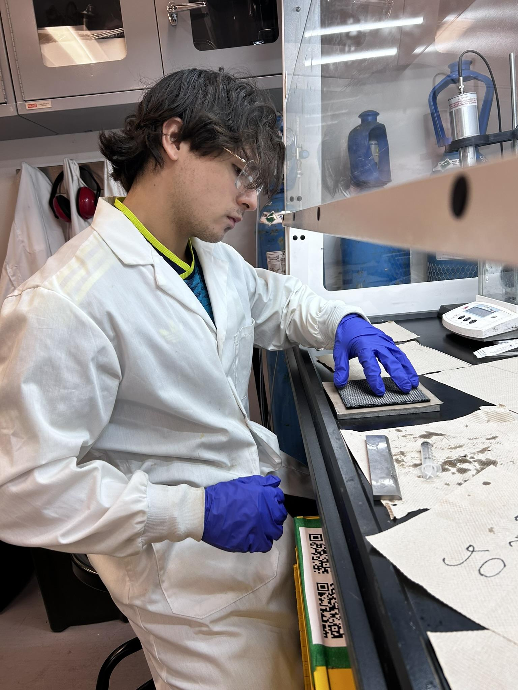
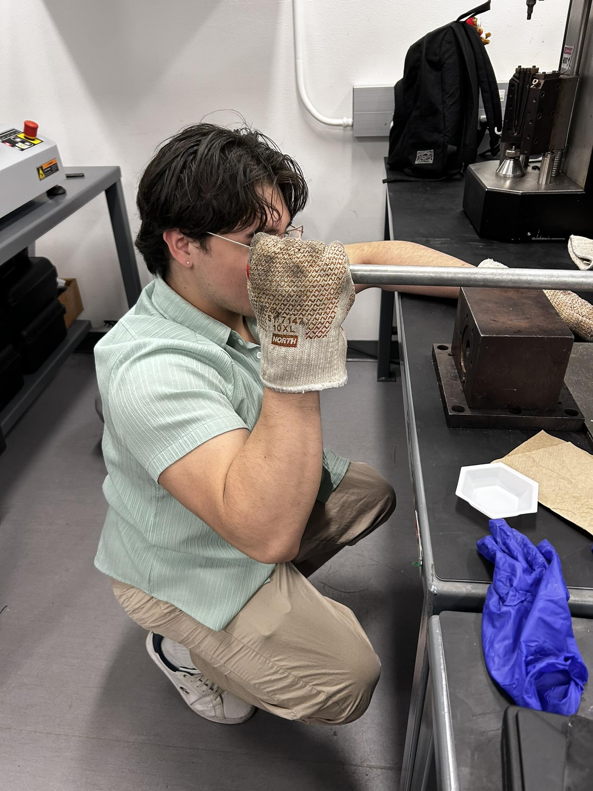

# Multifunctional Composites Manufacturing Laboratory (MCML)

**Undergraduate Researcher · University of Toronto, Department of Mechanical & Industrial Engineering · 2026**

Research in polymer composites, bio-inspired multilayers, nanofillers, composite fabrication and experimental materials characterization.

**Research supervision:** Prof. Patrick C. Lee and Rafaela Aguiar. The projects described here are collaborative laboratory research, not solely individual discoveries.

## Research stream 1 — Nacre-inspired polypropylene/graphene nanoplatelet multilayers

### Research question
Can a multilayer architecture inspired by the brick-and-mortar structure of nacre influence load transfer, crystallization and mechanical response in polymer nanocomposites?

### Visual reference — nacre architecture and fabricated specimens

These are the **same images used in the Google Slides portfolio**. The first is a research-presentation illustration (not a microscope photograph); the second is a photograph of a fabricated multilayer film sample.

| Nacre-inspired layer architecture | Multilayer composite film specimen |
| :---: | :---: |
|  |  |

### Materials and experimental approach
- Matrix: **polypropylene (PP)**; reinforcement: **graphene nanoplatelets (GnP)**, with processing work including **0.5 wt% GnP** formulations.
- Prepared structures with **1, 6, 18, 72 and 864 layers** using film stacking and repeated hot pressing.
- Explored processing temperature, pressure and thermal treatment as controls on crystalline structure and interfaces.
- Conducted micro-tensile testing, optical/microscopic characterization and differential scanning calorimetry (**DSC**).
- Examined potential differences between spherulitic and transcrystalline microstructures and how interphase architecture could affect mechanical behaviour.

### Experimental characterization — photos

| Micro-tensile testing equipment | Sample preparation and characterization |
| :---: | :---: |
|  |  |

These are photographs of research equipment and laboratory work, not plots of the tensile or DSC measurements.

### Reported observation
The **18-layer configuration** reached **31.25 MPa** in the reported micro-tensile assessment. This is a result in the evaluated sample set rather than a universal property of PP/GnP composites. The project also examined DSC features consistent with changes in crystalline response; interpretation requires comparison with detailed sample and control data.

### Research communication
The work was presented at **UNERD 2026** and received **third place** in the presentation category.

[UNERD research slides](https://docs.google.com/presentation/d/1KgYZRYe65nSL_JaR90hYRnEKhB3bIzOTMAVmGraeXac/edit) 

## Research stream 2 — Carbon-fibre/epoxy nanocomposites with halloysite nanotubes

### Goal
Study practical processing and manufacturing of carbon-fibre/epoxy composites containing halloysite nanotube (**HNT**) nanofillers.

### Manufacturing and laboratory work — photos

| Sample handling and preparation | Composite processing |
| :---: | :---: |
|  |  |

The images document hands-on laboratory activity; the original research notebook and presentation provide the technical details.

### Laboratory contributions
- Supported **mixing / sonication**, **vacuum degassing**, **spraying**, layup and **hot-press fabrication**.
- Worked with processing steps intended to improve consistency and repeatability of nanofiller-enhanced composite manufacturing.
- Contributed to iteration of lab manufacturing operations and throughput.

## Additional collaboration
Assisted with processing/property investigations for injection-moulded polymer specimens, including interpretation of tensile tests and the trade-offs between machine settings, sample quality and usable results.

## Techniques & tools
| Area | Methods |
| --- | --- |
| Processing | Hot pressing, layered layup, mixing, sonication, spraying, degassing |
| Characterization | Micro-tensile tests, DSC, microscopy, physical specimen assessment |
| Engineering approach | Experimental planning, materials comparison, data interpretation, technical presentation |

## Publications and intellectual property note
This page includes selected photographs and presentation illustrations that were already used in the engineering portfolio slides. It does not reproduce unpublished raw datasets, private lab notebooks, confidential process settings, or restricted materials. Reported project-level findings are drawn from the research presentation and abstract. Results should not be used as manufacturing specifications without verification.

## Explore related engineering work
[Full engineering portfolio](https://github.com/axelpengineering/axelpengineering) · [Composite enclosure design](https://github.com/axelpengineering/PPT-Composite-Box-Design)
